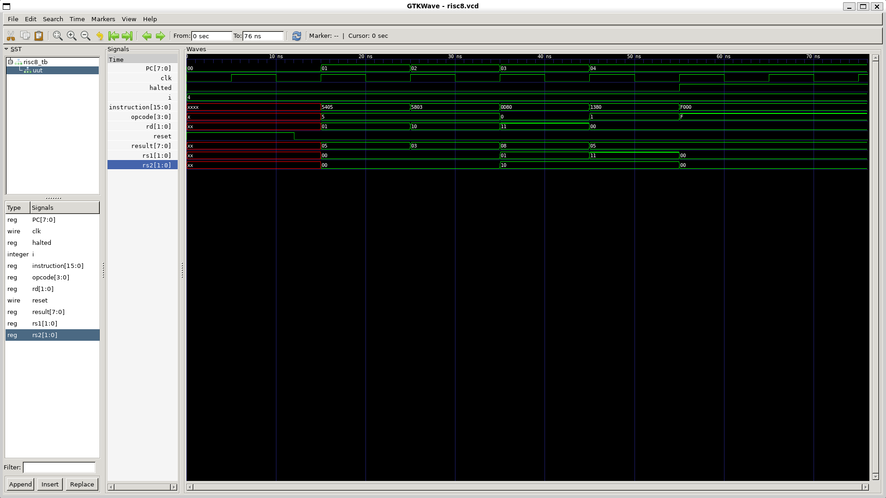
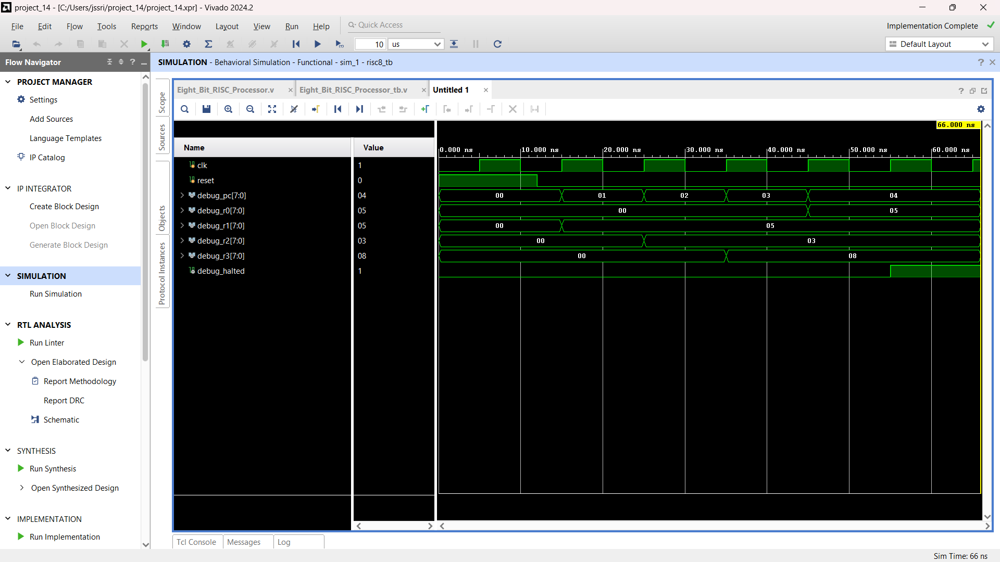
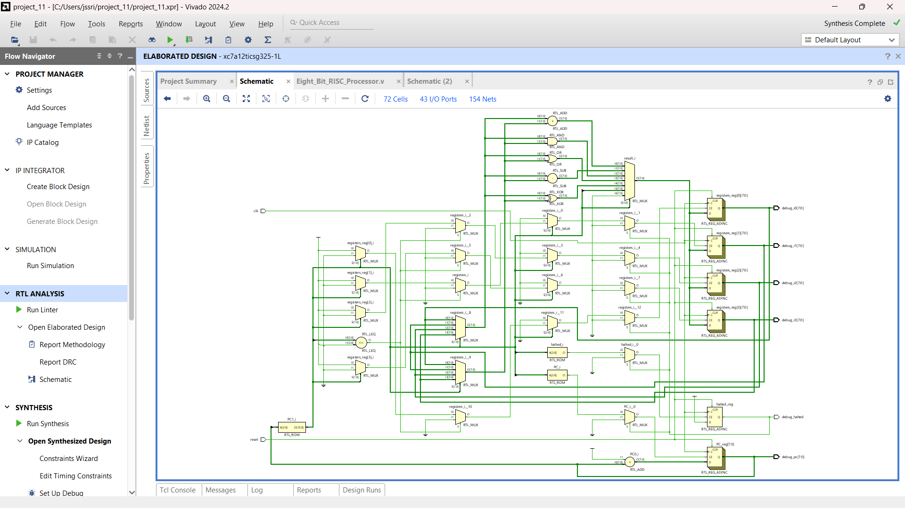

# 8-Bit RISC Processor

## Project Overview
An 8-bit RISC processor designed using Verilog HDL.

## Features
- 8-bit data processing
- Four general-purpose registers (R0-R3)
- 16-bit instruction format
- ADD, SUB, AND, OR and XOR operations
- Immediate LOAD instruction
- HALT instruction
- Program Counter and reset control

## Tools Used
- Verilog HDL
- Xilinx Vivado
- Icarus Verilog
- GTKWave
- Ubuntu Linux

## Simulation Results
| Signal | Result |
|---|---:|
| R0 | 5 |
| R1 | 5 |
| R2 | 3 |
| R3 | 8 |
| PC | 4 |
| HALTED | 1 |

**Simulation Status: TEST PASSED**

## GTKWave Waveform

## Vivado Simulation

## RTL Schematic

## Project Structure
- Verilog/: RTL source code
- Testbench/: Testbench code
- Simulation/: Waveforms and results
- RTL_Schematic/: RTL schematic image
- Documentation/: Project documentation

## Project Type
Digital Design | Verilog HDL | RISC Processor
